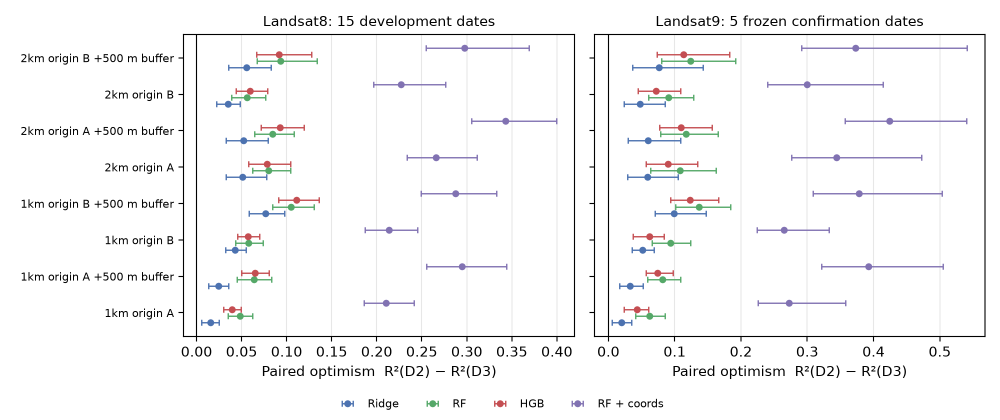
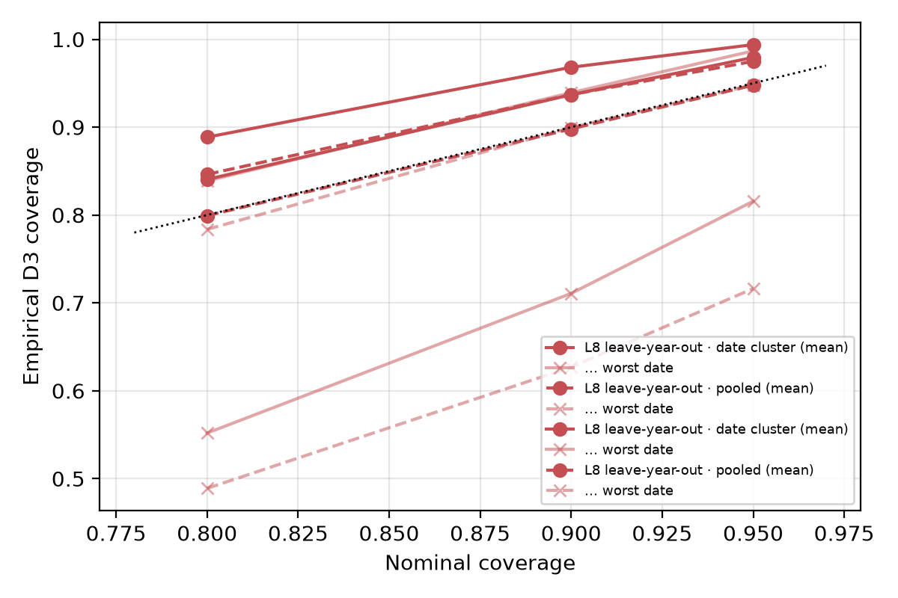

# Date-Only Validation Overstates Urban Heat Model Transfer: A Cross-Sensor Leave-Location-and-Time-Out Audit in New Town, Kolkata

*Submission draft (Round 11), 3 November 2026. Target: workshop or short-paper track on GeoAI / spatial data science / remote-sensing evaluation. Every number below is read from a file listed in `paper/CLAIM_EVIDENCE_R11.csv`.*

## Abstract

Machine-learning models of urban land-surface temperature (LST) are commonly validated on held-out pixels or held-out dates, while maps are used on new dates over areas with no thermal labels. We quantify how much date-only validation (leave-time-out, LTO) overstates performance relative to joint leave-location-and-time-out (LLTO) validation for within-acquisition LST anomalies in New Town–Rajarhat, Kolkata. Four fixed model families (Ridge, Random Forest, gradient boosting, and Random Forest with coordinates) were trained on 15 Landsat-8 Collection-2 Level-2 acquisitions (2018–2026) and tested on 5 Landsat-9 acquisitions frozen from metadata before any thermal pixel was read. Under the frozen quadrant protocol, Landsat-9 anomaly R² fell from 0.56–0.75 (LTO) to 0.14–0.20 (LLTO). In a paired re-analysis on identical hexagons across eight holdout geometries (1 km and 2 km blocks, two grid origins, with and without 500 m buffers), all 64 sensor × model × geometry mean gaps were positive, with two-way (year/acquisition × block) cluster-bootstrap 95% lower bounds of at least 0.052. The gap was 639/640 acquisition-level comparisons positive, 0.10–0.40 in R², and largest in every setting for the coordinate-aware Random Forest, which also ranked first under LTO in every setting. Residual spatial autocorrelation of LLTO errors remained significant (Moran's I 0.22–0.63), so inference uses clustered resampling rather than hexagon-level tests. Date-cluster conformal intervals calibrated on Landsat-8 raised worst-acquisition 90% coverage on Landsat-9 from 0.80 to 0.85 at the cost of wider intervals. The regimes are established; our contribution is a cross-sensor, geometry-robust quantification of LTO optimism for urban LST and the finding that the model favoured by LTO is the one it overstates most.

**Index Terms:** urban heat, land surface temperature, spatial cross-validation, domain shift, Landsat, evaluation methodology.

## I. Introduction

Urban LST maps from satellite-trained models are used to screen heat exposure at times and places where no thermal label exists. Validation that holds out only pixels (random CV) or only acquisitions (LTO) lets a model reuse what it has learned about the same locations, which is not available when mapping a new area. Structured validation is well established in ecology and environmental modelling [1], [3]–[6], but urban LST studies in our targeted sample rarely report a joint space–time holdout (Section II).

**Research question.** For urban LST anomalies, how much does LTO overstate LLTO performance, does the overstatement survive an independent sensor and the choice of holdout geometry, and does it change which model looks best?

**Contributions.**
1. A cross-sensor confirmation: models trained on 15 Landsat-8 dates and frozen before scoring show positive LTO−LLTO gaps on all 5 Landsat-9 dates for all four model families.
2. A geometry-robustness analysis: the gap is positive in all 64 sensor × model × geometry settings, with paired same-hexagon scoring and two-way cluster-bootstrap intervals.
3. A model-selection finding: the coordinate-aware Random Forest, which wins every LTO test, has the largest optimism in 16/16 settings; the best LLTO model changes in all 8 buffered settings.
4. A dependence-aware uncertainty audit: residual Moran's I, effective sample sizes, and pooled versus date-cluster conformal intervals evaluated leave-one-year-out.

A secondary planning analysis shows that persistent heat is robust to boundary registration uncertainty, whereas the joint heat-and-access screen is not (Section VI).

Negative results from earlier rounds are retained: absolute LST does not transfer across acquisitions; a site-memory residual correction improves date-only transfer but harms LLTO; residual spatial dependence is not removed by any model tested.

## II. Related Work

**Structured validation.** Roberts et al. [1] showed that random cross-validation understates error for structured data. Meyer et al. [3] defined leave-location-out (LLO), leave-time-out (LTO) and leave-location-and-time-out (LLTO) folds for spatio-temporal ML; our regimes D1, D2 and D3 are instances of these and are not claimed as new. Ploton et al. [4] showed random CV overstated the skill of biomass maps. Wadoux et al. [5] and Linnenbrink et al. [6] argue that validation should match the intended prediction situation; here that situation is a new acquisition over unlabelled areas, i.e. LLTO.

**Urban LST machine learning.** In a targeted, non-systematic sample of 8 recent urban LST or air-temperature ML studies (`paper/EVALUATION_PRACTICE_REVIEW.csv`), the accessible text reported random validation only (1), a temporal holdout (2, one of which also ran a separate station holdout for air temperature only), or did not state the split design (5). None reported a joint space–time holdout for LST. Most entries were coded from abstracts or records, so this indicates that joint holdouts are not routine in the application; it is not a prevalence estimate. The closest local study, Kundu et al. [7], models seasonal New Town–Rajarhat LST with boosted trees and SHAP; its protocol differs and we make no performance comparison.

**Relative-heat targets.** Per-acquisition normalisation of LST for cross-date comparison is established [2]; we use it as the target, not as a contribution.

## III. Study Area and Data

New Town–Rajarhat (NKDA), Kolkata: 537 hexagons of 250 m (EPSG:32643) within a boundary digitised from the official plan sheet. Its registration RMS is about 640 m, so all claims are township-level evaluation statistics; no hexagon-level planning recommendation is made.

- **Development domains:** 15 Landsat-8 C2L2 acquisitions, WRS 138/045, 15 Feb–15 May, 2018–2026, 8 calendar years; chosen from 695 catalogue items by metadata rules fixed before outcome inspection. One further scene failed the ≥180-valid-hexagon rule and is reported as excluded.
- **Confirmation domains:** 5 Landsat-9 C2L2 acquisitions (2022-03-19, 2023-03-06, 2024-04-25, 2025-03-11, 2026-02-26), one per year, frozen from metadata before any thermal pixel was read. All passed QA (204–271 valid hexagons).
- **Features:** NDVI, NDBI, MNDWI per hexagon; projected centroid coordinates for one model.
- **Target:** within-acquisition anomaly A_it = LST_it − mean_j LST_jt. The target-date mean is used only to score.

## IV. Evaluation Protocol

**Models (frozen in Round 10):** Ridge (α=10); RF (45 trees, min leaf 5, max features 0.8); HistGradientBoosting (80 iterations, min leaf 10); RF with coordinates. Spectral features are standardised per target domain using unlabeled target spectra only: the whole scene for D2, the held region only for D3. A whole-scene variant of D3 is reported as an information-set sensitivity.

| Regime | Held-out date | Held-out geography | Instance of |
|---|---|---|---|
| D0 | No | No (random 20%) | random CV |
| D1 | No | Yes | LLO |
| D2 | Yes | No | LTO |
| D3 | Yes | Yes | LLTO |

**Primary endpoint (frozen in Round 10):** optimism Δ = R²(D2) − R²(D3) per model, D3 by centroid quadrant.

**Round-11 robustness (added after the primary test):** D3 by square grid blocks of 1 km and 2 km, two grid origins, with and without a 500 m training-exclusion buffer, assigned to 5 folds; D2 and D3 scored on the same hexagons so Δ is a paired difference per acquisition.

**Inference.** Hexagons are never treated as independent units. Δ is averaged per acquisition. Intervals come from a two-way cluster bootstrap (2,000 replicates) that resamples calendar years (Landsat-8) or acquisitions (Landsat-9) and then 1–2 km blocks within each acquisition. Exact sign-flip tests use years (k=8) or acquisitions (k=5). With k=5 the smallest attainable two-sided p is 0.0625. The Round-10 protocol framed Δ as a loss but did not pre-declare a one-sided test, so the two-sided value is primary. Residual dependence of D3 errors is reported (Moran's I, 8 nearest neighbours, 499 permutations) with an AR(1)-style effective sample size n(1−I)/(1+I).

**D3 intervals.** Calibrated only on Landsat-8 D3 residuals with two rules fixed before scoring: pooled split-conformal and date-cluster conformal (quantile across calibration dates of each date's quantile). Evaluated leave-one-calendar-year-out within Landsat-8, then applied to Landsat-9; the Landsat-9 coverage is a second look at already scored data.

## V. Results

**Table I. Frozen primary endpoint (quadrant D3, held-region normalisation).** Development values from `domain_shift_model_matrix.csv`; confirmation from `round10_landsat9_confirmatory.csv`.

| Model | L8 D2 R² | L8 D3 R² | L9 D2 R² | L9 D3 R² | L9 gap (equal-date) |
|---|---:|---:|---:|---:|---:|
| Ridge | 0.578 | 0.057 | 0.562 | 0.164 | 0.315 |
| RF | 0.599 | 0.080 | 0.567 | 0.148 | 0.344 |
| HGB | 0.602 | 0.087 | 0.580 | 0.138 | 0.360 |
| RF + coords | 0.741 | 0.054 | 0.749 | 0.197 | 0.477 |

Landsat-8 gaps are 0.515–0.687 (8-year sign-flip p=0.0078). On Landsat-9 all four gaps are positive on all five dates (two-sided p=0.0625, the minimum attainable with five units). The development rank reversal (coordinate RF best under D2, worst under D3) did not replicate on Landsat-9.

**Table II. Paired optimism, 1 km blocks, origin A, no buffer** (`round11_optimism_summary.csv`).

| Sensor | Model | R²(D2) | R²(D3) | Δ | 95% CI (two-way) | Dates Δ>0 |
|---|---|---:|---:|---:|---|---:|
| Landsat-8 | Ridge | 0.578 | 0.472 | 0.106 | [0.071, 0.149] | 15/15 |
| Landsat-8 | RF | 0.600 | 0.456 | 0.144 | [0.112, 0.186] | 15/15 |
| Landsat-8 | HGB | 0.601 | 0.456 | 0.145 | [0.114, 0.187] | 15/15 |
| Landsat-8 | RF + coords | 0.741 | 0.482 | 0.259 | [0.221, 0.323] | 15/15 |
| Landsat-9 | Ridge | 0.562 | 0.452 | 0.110 | [0.055, 0.211] | 5/5 |
| Landsat-9 | RF | 0.567 | 0.420 | 0.147 | [0.091, 0.232] | 5/5 |
| Landsat-9 | HGB | 0.578 | 0.410 | 0.168 | [0.105, 0.264] | 5/5 |
| Landsat-9 | RF + coords | 0.749 | 0.472 | 0.277 | [0.190, 0.445] | 5/5 |

Paired gaps are smaller than the quadrant fold-macro gaps in Table I. Quadrants are larger, contain fewer folds per acquisition, and the fold-macro average weights small, poorly predicted quadrants heavily. The **size** of the overstatement therefore depends on holdout geometry and aggregation; its **sign** does not.

**Geometry robustness (Fig. 1).** Across 8 geometries × 4 models × 2 sensors, all 64 mean gaps are positive (range 0.102–0.400) and every two-way lower bound exceeds 0.05 (minimum 0.052). At the acquisition level, 639 of 640 gaps are positive; the single exception is RF on 2025-02-15 with a 1 km buffered split (−0.029). Buffers and 2 km blocks increase the gap, consistent with less spatial leakage between training and test locations.

*Fig. 1. LTO−LLTO optimism with two-way cluster-bootstrap 95% intervals across eight holdout geometries.*

**Model selection.** RF + coords has the highest D2 R² in all 16 sensor × geometry settings and the largest gap in all 16. The best D3 model changes to Ridge or RF in 9 of 16 settings: all 8 buffered settings and 1 unbuffered. Choosing a model by LTO therefore selects the model whose LTO score overstates its LLTO performance most, although its LLTO score is not uniformly the worst.

**Information-set sensitivity (Round 10).** Allowing whole-scene unlabeled spectra for D3 normalisation raised Landsat-9 D3 R² for RF + coords from 0.197 to 0.370. Labels of the test area are never used either way, but the information set must be declared.

**Error structure (Round 10, `error_variance_decomposition.csv`).** In D3 errors on Landsat-8, the date component is ≤0.5% of residual sum of squares, region given date 6–13%, date × region 7–9%, and within-domain variation 78–88%.

**Residual dependence (`round11_residual_moran.csv`).** D3 residual Moran's I is 0.22–0.63 across acquisitions and models, with permutation p ≤ 0.002 in every case; mean I is 0.37 (RF + coords) to 0.47 (Ridge) on Landsat-8. The approximate effective sample size is about 95–124 of 235–267 hexagons per acquisition. We do not claim to model this structure; inference relies on block resampling.

**D3 intervals (Fig. 2, `round11_interval_coverage.csv`).** Leave-one-year-out within Landsat-8 at nominal 90%:
- pooled conformal: mean coverage 0.899, worst acquisition 0.667, width 3.71 °C;
- date-cluster conformal: mean 0.937, worst 0.711, width 4.34 °C.

Applied to Landsat-9:
- pooled: mean 0.887, worst 0.804;
- date-cluster: mean 0.929, worst 0.845.

Date-cluster calibration improves worst-case coverage at the cost of wider intervals, but neither rule is calibrated for every acquisition.

*Fig. 2. Empirical D3 coverage of pooled and date-cluster conformal intervals.*

## VI. Secondary Planning Analysis: What Survives Boundary and Threshold Uncertainty

This section is descriptive screening, not an intervention recommendation. Inputs:
- persistent heat: the share of the 15 Landsat-8 dates on which a hexagon is in that date's hottest quintile (at least 7 valid dates required);
- walk-network distances to five service types (OSMnx, 4.8 km/h);
- WorldPop-2020 population;
- boundary-translation scenarios from Round 9, where a hexagon is "stable" if it stays inside the boundary under every 8-direction shift of 250, 640 or 962 m.

Results are in `round11_persistent_heat_boundary_robustness.csv`, `round11_planning_screen_sensitivity.csv` and `round11_access_threshold_sensitivity.csv`.

**Persistent heat is boundary-robust and core-concentrated.** At a 0.5 hot-frequency cutoff:

| Support | Hot hexagons | Residents | Share of support population |
|---|---:|---:|---:|
| All 537 | 46 | ~7,993 | 8.2% |
| 640 m-stable interior (109) | 18 | ~3,635 | 18.7% |

The concentration holds at cutoffs 0.4 and 0.6 (15–21 hexagons inside the 640 m-stable set). Mean hot frequency is 0.31 in the core zone, against 0.16 at the edge and 0.14 in the middle zone.

**Walking-access deficit is edge-concentrated and threshold-sensitive.** The mean 15-min service score is 0.29 at the edge, against 0.50 in the core and 0.49 in the middle zone. The share of residents reaching all five services is 0.0% at 10 min, 2.2% at 15 min and 11.9% at 20 min. The share reaching at most one service is 60.4%, 32.6% and 12.0% respectively. A widespread multi-service deficit is robust to the threshold; the 2.2% headline is not.

**The joint heat × poor-access screen is not boundary-robust.** Across 9 variants (walking 10/15/20 min × hot cutoff 0.4/0.5/0.6), 5–21 populated hexagons are flagged as persistently hot and reaching at most one service. Five hexagons (~229 residents) are flagged in all 9 variants, but none of them lies inside the 640 m-stable interior.

The two burdens sit in different parts of the township: hotter, better-served core versus cooler, under-served edge, consistent with the Spearman correlation of −0.29 between heat and access deficit. Where heat and access deficit overlap, the overlap is located exactly where boundary error matters. We therefore report heat persistence as a boundary-robust screening result and leave joint-burden targeting until an authoritative boundary is available.

## VII. Discussion

LTO lets a model reuse what it learned about the same locations on other dates, through coordinates or through location-correlated spectra. That reuse is unavailable when mapping an unlabelled area, so LTO measures something different from the deployment task. Three observations support this reading:
- the gap is largest for the model with explicit coordinates;
- it grows with buffers and larger blocks;
- an earlier site-memory residual correction improved LTO but harmed LLTO (Round 9).

For practitioners: report LLTO alongside LTO when maps will be used beyond labelled locations; declare which unlabeled target imagery is used for normalisation; and avoid selecting models by LTO alone.

## VIII. Limitations

- **One township.** No second city was tested; the satellite hosts were unreachable from the analysis environment for this round.
- **Retrospective anomaly target.** The target uses the observed scene mean; absolute LST transfer fails (Round 8 mean absolute R² −0.44 with ERA5-Land context).
- **Residual dependence remains.** Spatial autocorrelation of errors is significant for every model.
- **Intervals.** Coverage is not calibrated at the worst acquisition.
- **Small confirmation set.** Five Landsat-9 dates limit exact-test power, and the geometry analysis on Landsat-9 is a second look at already scored dates.
- **Thermal validity.** No in-situ LST validation was performed.
- **Literature sample.** The evaluation-practice sample is targeted and partly coded from abstracts.
- **Boundary.** Registration uncertainty (~640 m) removes every joint heat × access-deficit hexagon from the stable interior; joint-burden targeting needs an authoritative boundary. Population is a single modelled product (WorldPop 2020), and OSM facility completeness is not audited.

## IX. Conclusion

For urban LST anomalies in New Town–Rajarhat, date-only validation overstated joint space–time performance by 0.10–0.40 R² across all tested geometries. The overstatement replicated on an independent sensor and was largest for the model that date-only validation ranks best. Joint space–time holdouts should be standard when urban heat maps are used beyond labelled locations. The next step is an independent city under the same frozen protocol.

## References

[1] D. R. Roberts et al., "Cross-validation strategies for data with temporal, spatial, hierarchical, or phylogenetic structure," *Ecography*, 40, 913–929, 2017. doi:10.1111/ecog.02881
[2] "Examining urban heat island progression in Chennai: temporal insights from 2014 to 2024," *Scientific Reports*, 2026. https://www.nature.com/articles/s41598-026-57905-4
[3] H. Meyer, C. Reudenbach, T. Hengl, M. Katurji, T. Nauss, "Improving performance of spatio-temporal machine learning models using forward feature selection and target-oriented validation," *Environ. Model. Softw.*, 101, 1–9, 2018. doi:10.1016/j.envsoft.2017.12.001
[4] P. Ploton et al., "Spatial validation reveals poor predictive performance of large-scale ecological mapping models," *Nat. Commun.*, 11, 4540, 2020. doi:10.1038/s41467-020-18321-y
[5] A. M. J.-C. Wadoux, G. B. M. Heuvelink, S. de Bruin, D. J. Brus, "Spatial cross-validation is not the right way to evaluate map accuracy," *Ecol. Model.*, 457, 109692, 2021. doi:10.1016/j.ecolmodel.2021.109692
[6] J. Linnenbrink, J. Nowosad, H. Meyer, "Moving beyond spatial and random cross-validation in environmental modelling: a call for prediction-domain adaptive evaluation," arXiv:2605.13689, 2026.
[7] Kundu, Mukherjee, Mukhopadhyay, *Sustainable Cities and Society*, 140, 107246, 2026. doi:10.1016/j.scs.2026.107246 (full title to be confirmed from full text before submission)
[8] B. Mahata et al., "Spatiotemporal dynamics of land use/land cover (LULC) changes and its impact on land surface temperature: A case study in New Town Kolkata, eastern India," *Regional Sustainability*, 5(2), 100138, 2024. doi:10.1016/j.regsus.2024.100138

Additional application references coded in `paper/EVALUATION_PRACTICE_REVIEW.csv` are in `paper/references.bib`.
